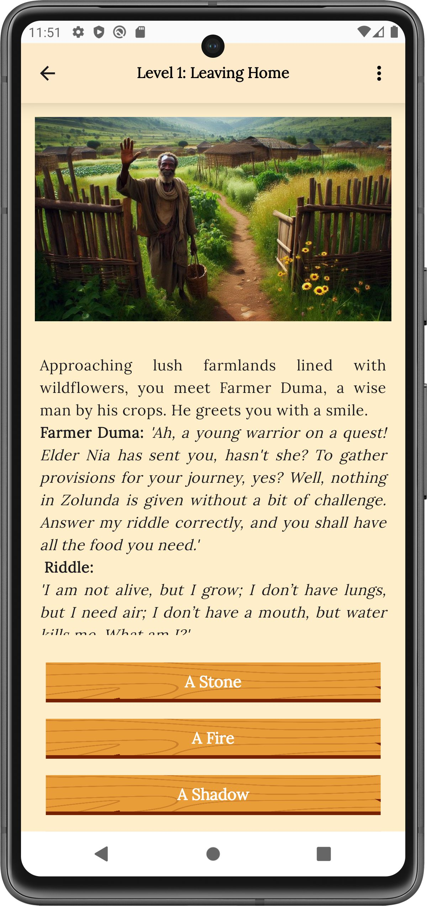
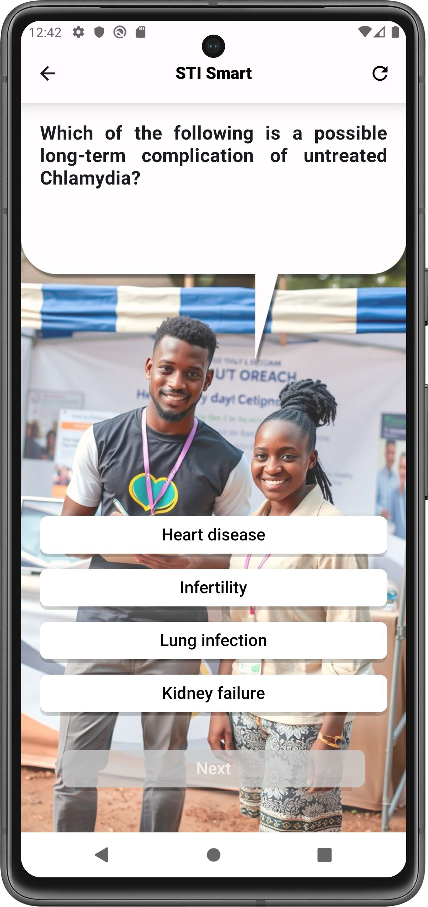
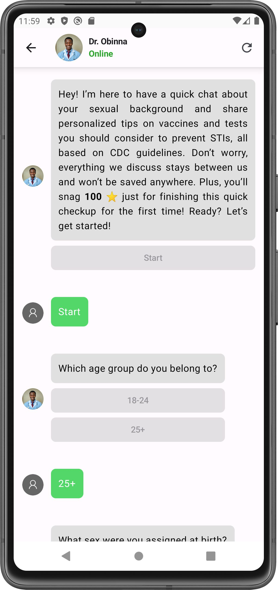
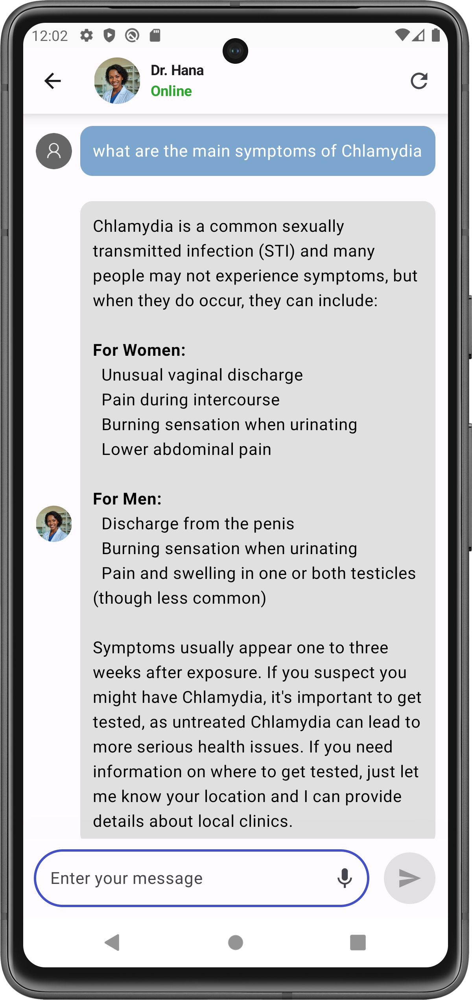
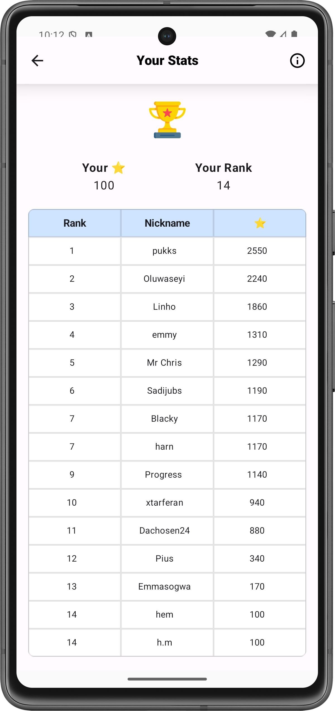

<p align="center">
  
</p>

<h1 align="center">STI Shield</h1>

<p align="center">
  
  
  
  <a href="https://github.com/hfetrati/stishield/actions/workflows/android-tests.yml">
    
  </a>
</p>

STI Shield is a native Android mHealth application built in **Kotlin** and **Jetpack Compose** using an **MVVM architecture**, designed to deliver gamified and chatbot-driven STI education to young adults, with a focus on African audiences. It integrates **LLM-based and rule-based chatbots** to provide an engaging, consistent, and personalized experience, with LLM interactions securely routed through a serverless **AWS backend** using **API Gateway**, **Lambda**, **Secrets Manager**, and **DynamoDB**.

## Features

- **Knowledge Quest** — Text-based adventure game where users progress through a story by completing tasks, solving challenges, and unlocking “Scrolls of Health” that deliver structured STI education from trusted sources (e.g., CDC, WHO).  

- **STI Smart** — Rule-based chatbot featuring African volunteer personas that present interactive quiz games across multiple difficulty levels, covering STI transmission, prevention, and common misconceptions.   

- **Health Guard** — Rule-based chatbot that conducts a personalized assessment and generates STI testing and vaccination suggestions based on user inputs and clinical guidelines (e.g., CDC). 

- **Safe Talk** — LLM-based chatbot that allows users to converse with selectable doctor personas (i.e., male or female), providing guidance on sexual health topics through interactive, adaptive responses. 

- **Leaderboard & Points System** — Users earn points by completing in-app activities (e.g., playing games,  finishing assessments, active usage time), and are ranked on a leaderboard to encourage continued engagement.  

- **User Guidance & Engagement** — Onboarding flow introducing app features, daily reminder notifications to promote continued use, and built-in support options (e.g., reporting issues) to improve usability and retention.  

## Screenshots

<div style="width: 100%; overflow-x: auto; white-space: nowrap;">
  <table style="min-width: 1000px; table-layout: fixed; width: 100%;">
    <thead>
      <tr>
        <th>Knowledge Quest</th>
        <th>STI Smart</th>
        <th>Health Guard</th>
        <th>Safe Talk</th>
        <th>Leaderboard</th>
      </tr>
    </thead>
    <tbody>
      <tr align="center">
        <td></td>
        <td></td>
        <td></td>
        <td></td>
        <td></td>
      </tr>
    </tbody>
  </table>
</div>

## Tech Stack

### Core
- **Language:** Kotlin  
- **UI:** Jetpack Compose, Material 3, Navigation Compose  
- **Architecture:** MVVM, Repository pattern  
- **Async:** Kotlin Coroutines  

### Backend & APIs
- **AWS API Gateway (HTTP API) + AWS Lambda (Node.js 22)** — serverless backend for OpenAI API access and user data management
- **AWS DynamoDB** — user data, leaderboard scores, and usage tracking
- **AWS Secrets Manager** — OpenAI API key and persona prompt ids, read by Lambda at runtime
- **AWS SAM** — infrastructure as code; the whole stack deploys from one template
- **OpenAI Responses API** — stored prompts per doctor persona, conversation state via response ids
- **Ktor client** — HTTP layer on the Android side

### Data Handling
- **Kotlinx Serialization / JSON** — structured app content  

### Local & System
- **SharedPreferences** — lightweight local persistence  
- **Android Components:** Service (usage tracking), BroadcastReceiver (reminders), AlarmManager (notifications)  


## Architecture

No API keys ship in the app. All cloud access goes through API Gateway.

```
                 ┌─────────────────────────┐
                 │       Android app       │
                 │    Kotlin + Compose     │
                 └────────────┬────────────┘
                              │  HTTPS / JSON
                              ▼
                 ┌─────────────────────────┐
                 │       API Gateway       │
                 └──────┬───────────┬──────┘
                        │           │
            POST /chat  │           │  POST /users/*
                        │           │  GET  /leaderboard
                        ▼           ▼
         ┌──────────────────┐   ┌──────────────────┐
         │   Lambda: chat   │   │   Lambda: user   │
         └────────┬─────────┘   └────────┬─────────┘
                  │                      │
                  ▼                      ▼
         ┌──────────────────┐   ┌──────────────────┐
         │ Secrets Manager  │   │     DynamoDB     │
         │  API key and     │   │   user records   │
         │  prompt ids      │   │                  │
         └────────┬─────────┘   └──────────────────┘
                  │
                  ▼
         ┌──────────────────┐
         │      OpenAI      │
         │  Responses API   │
         └──────────────────┘
```

Infrastructure is defined in a [SAM template](backend/template.yaml). See [backend/README.md](backend/README.md) for the API, data model and design notes, and [backend/prompts](backend/prompts/safe-talk-prompt.md) for the Safe Talk system prompt.

## Project Structure

```
.
├── app/src/main/java/com/hemad/stishield     # Android app
│   ├── ui/
│   │   ├── screens/        # Feature screens built with Compose
│   │   ├── theme/          # App styling (colors, typography)
│   │   └── utilities/      # Reusable UI components
│   ├── viewmodels/         # UI state management and interaction logic
│   ├── model/
│   │   ├── gpt/            # SafeTalk logic
│   │   ├── quiz/           # STI Smart logic
│   │   ├── game/           # Knowledge Quest logic
│   │   ├── riskassessment/ # Health Guard logic
│   │   ├── leaderboard/    # Leaderboard logic
│   │   └── common/         # Shared logic (backend client, user data, notifications)
│   └── MainActivity.kt     # Entry point and navigation setup
│
└── backend/                                  # AWS serverless backend
    ├── template.yaml       # SAM: API Gateway, Lambdas, DynamoDB, Secrets Manager, IAM
    ├── functions/
    │   ├── chat/           # Safe Talk proxy to OpenAI API
    │   └── user/           # Users, points, quiz scores, usage, leaderboard
    └── prompts/            # System prompt used for the Safe Talk doctor personas
```


## Setup

### Prerequisites
- Android Studio with Android SDK 24+
- An AWS account, the AWS CLI and the AWS SAM CLI
- An OpenAI API key and two stored prompts (one per doctor persona)

### 1. Deploy the backend

```bash
cd backend
sam build
sam deploy --guided
```

Then set the OpenAI key and prompt ids in the secret identified by the `OpenAISecretArn` deploy output. Full steps are in [backend/README.md](backend/README.md#deploy).

### 2. Point the app at it
Create or update `local.properties` in the project root with the `ApiUrl` output from the deploy:

```properties
AWS_URL = https://<api-id>.execute-api.<region>.amazonaws.com
```

### 3. Build and run
1. Open the project in Android Studio
2. Sync Gradle
3. Run on an emulator or Android device

## License

This project is licensed under the [MIT License](LICENSE). Third-party assets are excluded; see [Assets & Attribution](#assets--attribution).


## Assets & Attribution

This project includes third-party assets:

* Some illustrations were generated using Microsoft Designer (AI-generated content).
* Icons are sourced from Flaticon and Freepik.

These assets are used under their respective licenses and remain the property of their original creators.

## Author

**Hemad Fetrati**

[](https://www.linkedin.com/in/hemadfetrati/)
[](mailto:sti.shield.app@gmail.com)
